# Task 067C — WLED Command Ordering and Recovery Architecture

**Repository:** `magicaussie/wledger`
**Branch:** `development/chatgpt-m6-m7`
**Starting commit:** `32c7ce2cd6384a0ffa6f3478213614b31ae23594`
**Scope:** Architecture/feasibility investigation only. No application source, database schema, production configuration, or firmware changes are authorized or made.

## Executive summary

**Unmodified WLED cannot provide the required safe-release guarantee through its standard HTTP JSON API or WebSocket API.** Both APIs accept desired-state updates, but neither exposes a durable controller-side generation fence, command sequence number, command-drain barrier, or correlated applied-and-drained receipt. A successful response and a later GET are not proofs that an older request can no longer be processed or that the physical LED transfer has completed.

The Task 067B test is a deterministic mock reproduction, not proof that stock WLED queues a fully parsed JSON activation and later applies it. The current WLED JSON handlers appear to deserialize a complete request synchronously into logical state; output rendering happens later in the main loop, and some bus drivers transfer asynchronously. The important uncovered gap remains: an earlier request can be delayed before the WLED handler applies it, while a later cleanup sent over a different connection is handled and acknowledged first. Stock APIs expose no rule or barrier that makes that ordering impossible. The precise delivery/handler schedule depends on firmware, AsyncWebServer/network-stack versions, and controller hardware, none of which were supplied or tested on hardware.

**Recommendation:** use controller-side generation fencing integrated at the point where WLED commands are applied, plus durable per-controller command/outbox and Locate-generation records in WLEDger. A dedicated gateway can simplify dispatch and auditing, but is **not sufficient by itself**. A usermod endpoint is not automatically enough: the firmware must validate the generation at the actual application point, invalidate queued stale work, order the targeted cleanup after any current operation, and provide a real queue/output-drain acknowledgement. This architecture is **CONDITIONAL / UNVERIFIED** until implemented against pinned WLED builds and verified on every supported output-driver class.

**Physical WLED testing remains blocked.** No production, staging, or physical controller was contacted, and neither this report nor the simulator is hardware acceptance evidence.

## 1. Baseline, scope, and safety

- `HEAD` was `32c7ce2cd6384a0ffa6f3478213614b31ae23594`; branch was `development/chatgpt-m6-m7`.
- `origin/development/chatgpt-m6-m7` resolved to the same SHA at investigation start.
- Initial worktree contained only the previously dirty/protected items: `docs/OMO_HANDOVER.md`, `.task055b-staging/`, and `docs/TASK056_FUNCTIONAL_AUDIT.md`. They were not edited, staged, or cleaned.
- `AGENTS.md` was reviewed. Its branch-publication and safety restrictions apply. No hardware requests, deploys, or changes to source/schema/firmware were made.
- Read `docs/TASK067_LOCATE_FAULT_ACCEPTANCE_REPORT.md` and `docs/TASK067B_MUTATION_CONTENTION_RECOVERY_REPORT.md`. Task 067 is **PARTIAL**; Task 067B is **PARTIAL / BLOCKED** due the delayed-activation recovery failure.
- Reviewed `internal/wled/physical_locate_delayed_delivery_test.go`, `internal/wled/physical_locate.go`, and `internal/wled/client.go`, plus the Task 067B test/report evidence.
- Upstream code reviewed at official WLED release `v16.0.1` (tag commit [`29b389df1c1aaec6ff53aea742d17063b985906c`](https://github.com/wled/WLED/tree/29b389df1c1aaec6ff53aea742d17063b985906c)) and current upstream `main` as of 2026-10-13 (commit [`5c2b3ea6408f63be0d727d4a824b89a8598e6a7d`](https://github.com/wled/WLED/tree/5c2b3ea6408f63be0d727d4a824b89a8598e6a7d)). The WLED release API identified `v16.0.1` as the latest release during this investigation. **The firmware version/build, platform, network stack, and LED bus drivers installed on the intended controllers are unknown.**

The change set for this task is this report and `scripts/task067c_command_order_model.py`, a deterministic, test-only architecture model. The latter is not production code or a WLED implementation.

## 2. Task 067B failure analysis

`TestPhysicalLocateDelayedActivationCanRelightPixelsAfterAcknowledgedRecovery` establishes this sequence in a loopback mock:

1. WLEDger commits the `activating` session, immutable controller/range/command snapshot, and `may_have_received=1` before issuing activation.
2. The mock receives the complete targeted activation request body. It stops at a barrier before applying the color to its framebuffer.
3. The sending child process is killed with `SIGKILL`. The mock retains its independently blocked handler/request despite the client process disappearing.
4. A restarted service recovers from the durable target snapshot and sends targeted black commands. The mock applies cleanup and returns HTTP success responses.
5. WLEDger persists `may_have_received=0` and `state=stopped`.
6. The test releases the earlier mock barrier. The mock applies the red activation after cleanup acknowledgement and after durable ownership release. Owned pixels relight; unrelated mock pixels are unchanged.

This is reproducible evidence against the *current WLEDger assumption that a 2xx cleanup response orders or drains every older command*. It does **not** establish the exact event sequence inside stock WLED firmware. In the test, “received” means the mock has read the HTTP body; “not applied” means only that the mock framebuffer has not yet been changed. The test does not distinguish firmware parser execution, WLED logical state mutation, render-loop execution, LED-driver transfer, or light emission.

The current WLEDger client uses an `http.Client` with a two-second timeout. `postStateAt` POSTs to `/json/state`, accepts any 2xx status, closes (but does not interpret) the response body, and treats that as success. Locate holds database operation claims and persists an attempt marker before activation; Stop persists `stopping`, performs saved-range black writes, clears the target marker after each successful client call, then persists terminal state. These mechanisms coordinate WLEDger processes, not requests already accepted/buffered by a controller or independent WLED writers.

### Event vocabulary

| Event | Evidence/meaning | Does not by itself prove |
|---|---|---|
| Request bytes received | Some/all TCP payload reached a network stack/socket | Complete HTTP body, valid JSON, handler invocation, or command application |
| Request parsed | JSON handler decoded a complete valid state object | Physical output updated |
| Command queued | An implementation-specific executor retained work for later | That work will be canceled on client death or superseded by Stop |
| Logical state applied | WLED’s in-memory segment/pixel model reflects the command | Render loop has composed a frame, LED bus has transmitted it, or photons match |
| Physical output updated | Driver transfer completed (if the driver exposes such completion) | Exact optical/color output absent a sensor; no external writer will change it later |
| HTTP/WS response sent | Controller attempted to send a response | Client received it, unless transport receipt is separately established |
| Client acknowledgement received | WLEDger received an HTTP status/WS message | Correlation to a command, durable controller state, drain of older work, or rendered output |

### Ordering required for safe recovery

For each affected controller, recovery must establish all of the following before releasing durable ownership:

1. Every possibly transmitted activation is represented by durable ownership and a controller-scoped generation/sequence.
2. The controller has durably advanced a rejection frontier beyond every activation generation that could still be delayed or retried.
3. The fence is checked at the **actual command-application point**, not just at network receipt. An already-running apply must finish before the fence’s cleanup commit, and queued older commands must be rejected when they reach application.
4. Targeted black cleanup for exactly the saved ranges is applied after that frontier, with no global-off command and no write outside the saved ranges.
5. The controller reports a correlated acknowledgement whose semantics include fence advancement and command-queue drain. If safe release also claims final physical output, the receipt must include completion of the relevant LED-driver transfer; logical state alone is insufficient.
6. WLEDger durably records each target receipt and only then commits session terminal state. Any unknown identity, timeout, missing acknowledgement, persistence failure, or offline target retains ownership.

A quiet period, successful GET, repeated GET, disconnected socket, or 2xx status does not prove items 2–5.

## 3. WLED source and API findings

### Primary references inspected

- Official [WLED JSON API documentation](https://kno.wled.ge/interfaces/json-api/): POSTs to `/json/state` update state fields; `v:true` requests a verbose state response; individual LED control uses `seg[].i`. The docs explicitly recommend making individual-LED calls sequentially rather than in parallel. This is client guidance, not a cross-connection device-ordering contract.
- Official [WLED WebSocket documentation](https://kno.wled.ge/interfaces/websocket/): `/ws` exposes JSON updates and broadcasts; it describes replies as either state/info or `{"success":true}`, depending on whether a broadcast is imminent; broadcasts are rate-limited/coalesced; split text messages are not supported.
- Related upstream discussions, not protocol guarantees: [PR #5013](https://github.com/wled/WLED/pull/5013) changed WLED UI resource loading to sequential requests / a single connection for stability under low memory and poor Wi-Fi; it does not specify state-command ordering. [PR #5737](https://github.com/wled/WLED/pull/5737) explored a separate versioned ESP-NOW API with queues/retry deduplication and best-effort state pushes; GitHub lists it closed without merge. Neither adds generation fencing or a drain guarantee to stock HTTP/WS.
- WLED `v16.0.1` [`wled_server.cpp`](https://github.com/wled/WLED/blob/29b389df1c1aaec6ff53aea742d17063b985906c/wled00/wled_server.cpp), `initServer`: installs an `AsyncCallbackJsonWebHandler` for `/json`; after obtaining the JSON buffer it calls `deserializeState(root)` and then sends HTTP 200 `{"success":true}` (or verbose JSON when requested). If the shared JSON buffer cannot be acquired, the handler defers the response rather than issuing a sequencing token.
- WLED `v16.0.1` [`json.cpp`](https://github.com/wled/WLED/blob/29b389df1c1aaec6ff53aea742d17063b985906c/wled00/json.cpp), `deserializeSegment` / `deserializeState`: individual LED values are copied into segment raw pixels synchronously and `strip.trigger()` requests a redraw. The state handler updates WLED’s logical state before returning to the HTTP/WS handler.
- WLED `v16.0.1` [`ws.cpp`](https://github.com/wled/WLED/blob/29b389df1c1aaec6ff53aea742d17063b985906c/wled00/ws.cpp), `wsEvent`: accepts a complete single-frame text message, deserializes it, calls `deserializeState(root)` inline, then sends `{"success":true}` or a state response where applicable. It does not attach a client command ID to that response. Multi-frame text is not reassembled; an error is sent.
- WLED current-upstream [`wled_server.cpp`](https://github.com/wled/WLED/blob/5c2b3ea6408f63be0d727d4a824b89a8598e6a7d/wled00/wled_server.cpp), [`json.cpp`](https://github.com/wled/WLED/blob/5c2b3ea6408f63be0d727d4a824b89a8598e6a7d/wled00/json.cpp), and [`ws.cpp`](https://github.com/wled/WLED/blob/5c2b3ea6408f63be0d727d4a824b89a8598e6a7d/wled00/ws.cpp) were also inspected for current-main behavior. They retain the same relevant callback → deserialization → response shape; this is a source snapshot, not a statement about the unknown installed build.
- WLED `v16.0.1` [`wled.cpp`](https://github.com/wled/WLED/blob/29b389df1c1aaec6ff53aea742d17063b985906c/wled00/wled.cpp), `WLED::loop`, calls `strip.service()` in the main loop independently of the HTTP handler.
- WLED `v16.0.1` [`FX_fcn.cpp`](https://github.com/wled/WLED/blob/29b389df1c1aaec6ff53aea742d17063b985906c/wled00/FX_fcn.cpp), `WS2812FX::service` / `show`: rendering and `BusManager::show()` occur later. The source explicitly notes that some buses transmit asynchronously and `show()` can return before all data has been sent. The exact driver behavior is platform/build-dependent.

### Direct answers: HTTP and stock firmware

| Question | Finding for inspected v16.0.1/current source | Safety consequence |
|---|---|---|
| Are HTTP JSON requests serial or concurrent? | WLED uses an asynchronous HTTP server callback. State parsing uses a shared JSON-buffer lock, which excludes unsafe simultaneous buffer use; source/API does not promise FIFO acquisition or global ordering across connections. The callback can be delayed/deferred. | “One controller” or shared parser buffer is not evidence that requests from separate TCP connections execute in send order. |
| Does successful POST mean the state update was applied? | For a complete valid request handled by inspected code, `deserializeState` runs before the ordinary 200 response. That supports a **logical in-memory state mutation** acknowledgement. It does not guarantee rendering, driver transmission, or optical output. The WLEDger client checks only 2xx and does not validate the response body. | HTTP 200/2xx is not the required drain/physical acknowledgement. |
| Can an earlier received request execute after a later request is acknowledged? | The source has no general command FIFO/barrier contract across connections. It applies JSON when a complete request reaches its callback. A request that has only partially arrived, is delayed before parsing, or is deferred can be overtaken by a completed request on another connection; WLED exposes no cross-connection ordering barrier. Conversely, source inspection did **not** find a post-parse JSON command queue that intentionally holds a parsed activation for arbitrary later application. | The exact 067B post-read mock pause is not proven to exist inside stock WLED, but stock APIs do not rule out older request processing after later cleanup on independent connections. |
| What if the sender disconnects? | There is no JSON command cancellation token or rollback. If the handler already parsed/applied state, disconnecting cannot undo it. If the body/frame was incomplete, the transport may discard it, but the API does not return a durable proof of discard. WS disconnect handling logs/clears live-preview state; it does not cancel a command sequence. | A client timeout/crash leaves delivery/application uncertain. Treat the request as possibly received. |
| Are commands queued across network connections? | No dedicated standard JSON command queue or documented cross-connection FIFO was found. There are per-request network/body buffers, shared-JSON-buffer arbitration, deferred rendering in `strip.service()`, and potentially asynchronous bus transfers. | Absence of an explicit command queue is not a drain guarantee. |
| Can a request remain pending after the client timeout? | A request may be in transit, waiting for its complete body/handler, or already applied while its response is lost. WLED has no status endpoint for querying completion by request ID. Exact close/discard behavior depends on the AsyncWebServer/network-stack version and connection state. | WLEDger cannot safely infer “not applied” from a timeout or process death. |
| Do different HTTP connections have defined order? | No ordering promise is documented or exposed. TCP preserves byte order within a connection, not application order among independent connections. | A new recovery connection is not a known boundary after the old connection. |
| Client sequence numbers? | No standard JSON API field is a command sequence/idempotency key. Fields such as `time`, `tb`, presets, and `v` are not stale-command fencing. | No controller-side stale-command rejection. |
| Generation tokens / stale rejection? | None in the standard `/json/state` API or inspected WS JSON API. | A later cleanup cannot invalidate an older activation. |
| Application command-drain barrier? | None found in the standard APIs or source. `GET /json/state` reports current logical state; it is not a drain/status barrier. | Repeated GETs/sleeps are not proof. |
| Does reboot/reconnect invalidate the guarantee? | Standard JSON carries no persistent epoch; controller reboot/reconnect does not expose a new command generation or reject stale retries. A reboot may drop old TCP state, but WLEDger cannot prove that every queued/retried command is gone and no stock API establishes a new ordering boundary. | Reconnection alone is not recovery proof. |
| Effects/presets/transitions/other writers? | WLED has state transitions, presets/playlists/nightlight, UI/API writes, WebSocket, realtime inputs (including UDP/E1.31/Art-Net/DDP), and optional integrations/usermods. Some can alter state independently of Locate. Bus transfer and render timing are separate from JSON acknowledgement. | Even a Locate-only fence must account for other writers or exclude them from the owned ranges. |

### Version limits

WLED’s public JSON API contract is a state-setting API, not a durable command log. The reviewed v16.0.1 source has synchronous logical-state deserialization, but asynchronous networking and per-platform output drivers vary. WLED’s release notes also identify a major ESP32 platform/core change for v16.0.0. Without the installed build SHA, platform, AsyncWebServer/Arduino core dependency revisions, and bus type, no stronger statement about a particular controller’s request-body cancellation or output completion timing is supportable. An upstream source review is not a substitute for testing that exact build.

## 4. HTTP ordering assessment (Option A)

A single sender-side operation mutex, one outstanding request per controller, no parallel requests, a persistent connection where available, request/response logging, and no blind activation retry are worthwhile **risk reductions**. They reduce WLEDger’s own reordering and clarify diagnostics. They do not solve:

- a sender crash after writing bytes but before learning whether the controller parsed them;
- an older request that has not completed/parsing on its connection while a later recovery request arrives on another connection;
- the absence of a controller sequence number or stale-generation check;
- HTTP response sent after logical parse but before the render loop and asynchronous bus transfer finish;
- controller restart, connection-pool replacement, multiple WLEDger processes, or non-WLEDger writers.

The Task 067B mock directly demonstrates why sender-side SQLite serialization cannot revoke a request that has crossed the process boundary. Restricting HTTP to one persistent connection could be a useful operational policy only if the exact device/server implementation provides a verified per-connection processing and drain contract and every crash/reconnect path preserves it. Stock WLED does not document that contract. **Classification: RISK REDUCTION ONLY.**

## 5. WebSocket assessment (Option B)

### What improves

A single WebSocket is a persistent TCP connection. TCP preserves message bytes on that connection and WLED’s inspected `wsEvent` processes a complete single-frame JSON message inline. Sending one message, waiting for its response, and only then sending the next can reduce client-side overlap and avoid routine HTTP connection-pool variability.

### What does not improve enough

- `{"success":true}` has no command identity, generation, sequence, or stable “applied and drained” semantics. State broadcasts are rate-limited/coalesced and can reflect another source.
- A command already processed before response loss remains applied; disconnection cannot roll it back.
- A new connection after process death has no ordering relationship with work that was incomplete, delayed, or deferred on the old connection. A WS reconnect is not an application-level barrier.
- Multiple WS clients are supported; one client’s cleanup does not carry a device-side stale-command frontier over other clients.
- The source does not implement a standard controller queue-drain response. Render and bus transfer are separate.
- The generic queue model reproduced below is **not** evidence that stock WLED queues its WS JSON messages. The inspected stock `wsEvent` applies complete messages inline; it rejects unsupported split text frames. The point is that changing transports does not itself add generation fencing or drain semantics.

**Deterministic WebSocket simulation:** the test-only model places a complete activation on connection A in an application queue, disconnects A, applies/acknowledges targeted cleanup on connection B, then drains the queued activation. It reproduces the 067B ordering and relight. This models the failure class requested; it deliberately assumes a server-side post-receive queue, which was not found in stock WLED’s WS JSON path. The scenario demonstrates that FIFO *within each connection* does not order two connections or cancel already queued work. **Classification: INSUFFICIENT for the guarantee; same-connection serialization is RISK REDUCTION ONLY.**

## 6. Architecture comparison

| Option | Classification | Benefit | Why it does/does not satisfy safe release |
|---|---|---|---|
| **A — Stock HTTP JSON** | **RISK REDUCTION ONLY** | Existing supported interface; serialize one WLEDger sender, log payloads, and avoid concurrent calls. | No sequence/generation token, stale rejection, correlated command receipt, or drain barrier. A process timeout/crash and independent connections leave application status uncertain. |
| **B — Persistent WebSocket** | **INSUFFICIENT** | One connection preserves its TCP message order and can reduce polling/connection churn. | No command ID/sequence/fence, no durable connection epoch, no queue-drain/physical-output acknowledgement. Reconnect/multiple clients break any sender-only ordering assumption. |
| **C — Dedicated command gateway** | **INSUFFICIENT by itself** | One durable outbox, per-controller worker, audit log, single dispatcher, and cleaner multi-process coordination. | Gateway serialization cannot retract an older request already accepted/buffered by WLED. Gateway restart/lost ACK leaves the same uncertainty unless the controller supplies a fence/drain barrier. Useful as an optional dispatcher, not the safety primitive. |
| **D — Controller-side generation fencing** | **CONDITIONAL** | Device rejects obsolete work at its actual application point; correlated sequence and fence receipts make recovery decidable. | Necessary practical change with stock APIs, but no such standard feature exists. Only qualifies after custom implementation, output-driver drain semantics, writer controls, persistence/reboot tests, and exact-build validation. |
| **E — Bounded delay / verify** | **RISK REDUCTION ONLY** | Quiet time, repeated state reads, and telemetry can reduce likelihood or detect some failures. | No defensible maximum in-flight request delay or state-read-as-drain property has been established. Arbitrary sleep/GET cannot prove no stale activation remains. |

No option is **GUARANTEED** based solely on evidence available today.

## 7. Recommended minimum safe protocol (design only)

### Controller command envelope

One command per controller should carry at least:

```json
{
  "protocol": "wledger-fence-v1",
  "installation_id": "stable-provisioned-installation-id",
  "controller_id": "stable-provisioned-controller-id",
  "boot_epoch": 412,
  "generation": 90017,
  "sequence": 288104,
  "command_id": "unique-idempotency-id",
  "operation": "set_ranges",
  "output_fingerprint": "verified-controller-output-layout-hash",
  "ranges": [
    {"segment_id": 10, "start": 96, "stop": 100, "rgbw": [0, 0, 0, 0]}
  ]
}
```

These are proposed fields, not a WLED API that exists today. `segment_id` plus `[start, stop)` follows the existing WLEDger/WLED segment-local command mapping; the output fingerprint binds that saved mapping to the verified controller output layout. The controller must validate stable installation/controller identity, protocol/build capability, authorization, epoch, generation, sequence, fingerprint, segment identity, and bounds. Locate commands use only saved targeted ranges and desired RGB(W) values; no `GlobalOff` or whole-controller power change is permitted.

A correlated acknowledgement should include `controller_id`, current `boot_epoch`, `generation`, `sequence`, `command_id`, result (`applied`, `duplicate`, `stale_generation`, `stale_epoch`, `rejected`), and explicit processing milestones. The safe-stop response must mean:

- this generation is durably the controller’s rejection floor;
- all commands in prior generations are rejected if they reach the application point later;
- any already-applying older command completed before this cleanup was committed;
- saved targeted black writes were applied after the fence; and
- the controller’s command executor is drained through this sequence.

If ownership release is intended to imply LEDs are physically black already, the receipt must additionally mean the output transfer finished for supported buses. A generic success reply, WLED JSON state snapshot, WS broadcast, or queue acceptance is not this acknowledgement. Even a driver-complete receipt is not optical verification of wiring, LED faults, or color calibration.

### Epoch, generation, sequence, and identity rules

- **Controller identity:** use an installation-provisioned, stable device identity distinct from a mutable IP/port and distinct from an unverified name/MAC string. The identity must be checked on every recovery endpoint. A replacement controller does not inherit the old controller’s identity automatically.
- **Boot epoch:** controller advances a persistent monotonic boot epoch before accepting commands after every reboot. Commands bearing the prior epoch are rejected. One durable write per boot is preferable to a flash write per LED request; endurance, atomicity, and power-loss behavior must be measured for selected hardware. If the epoch cannot be advanced/read safely, the controller remains unavailable for fenced Locate.
- **Generation:** WLEDger durably allocates a strictly increasing per-controller 64-bit generation. Every activation is assigned a generation before transmission. Stop/recovery first reserves a newer generation and sends targeted cleanup under it; the controller durably advances its generation floor before acknowledging the fence. Delayed activations from an older generation then fail at application time.
- **Sequence:** WLEDger stores a per-controller monotonic sequence and serializes outstanding commands. The controller checks sequence at application, not at socket receipt. Sequence state may be volatile within one boot epoch if a changed persistent boot epoch invalidates every old-epoch packet/retry. Do not wrap; overflow fails closed and requires a controlled re-enrollment/epoch procedure.
- **Command identity/idempotency:** exact retry of an already applied command ID and identical payload returns the original result without reapplying. Reuse of an ID with a different payload is rejected. After reboot, a prior-epoch retry is stale; WLEDger re-handshakes/reconciles and issues a new current-epoch recovery command while durable ownership remains unresolved.
- **No per-pixel flash writes:** persist generation advances and boot epoch transitions, not every pixel/sequence. Command sequence and a bounded last-command dedupe record can remain RAM-resident per boot if every reboot changes the durable epoch. NVS commit atomicity and actual flash endurance remain implementation-test items.
- **Multi-controller:** each target has independent identity, epoch, generation, sequence, command status, and cleanup receipt. WLEDger releases the session only when every possibly-contacted target is fenced, cleaned, drained, and durably resolved.

### Durable WLEDger records (proposal; no schema change made)

1. **Per-controller protocol state:** stable controller identity, negotiated protocol/build/capability version, highest allocated generation, next sequence, most recently observed boot epoch, and capability verification time/build digest.
2. **Durable command outbox:** command ID, controller ID, Locate session ID, boot epoch, generation, sequence, exact serialized envelope/hash, operation/ranges/value, state (`prepared`, `possibly_sent`, `acknowledged`, `rejected`), attempts/timestamps, and correlated receipt.
3. **Immutable session target:** existing saved endpoint identity, output fingerprint, exact allocated ranges and cleanup commands, plus protocol identity/epoch/generation/sequence and per-target recovery phase. Never derive recovery ranges from current layout after activation.
4. **Ownership release transaction:** record all target receipts and terminal session state atomically. On partial DB failure, keep `may_have_received` / recovery ownership set and retry reconciliation.

The outbox must be committed before network send. A sender crash after the write sets status to possibly sent, never “not delivered.”

### State machine

```mermaid
stateDiagram-v2
    [*] --> Reserved: durable ranges + generation + ownership
    Reserved --> Activating: persist possibly-sent command before send
    Activating --> Active: correlated apply receipt
    Activating --> RecoveryRequired: timeout, crash, or uncertain delivery
    Active --> StopFenceReserved: allocate higher generation durably
    RecoveryRequired --> StopFenceReserved: restart/recovery from saved target
    StopFenceReserved --> Fenced: controller persists newer generation floor
    Fenced --> CleanupApplied: targeted black applied after old work is fenced
    CleanupApplied --> OutputDrained: executor and supported bus transfer drained
    OutputDrained --> TargetResolved: receipt persisted for this controller
    TargetResolved --> Stopped: every target resolved; terminal commit
    StopFenceReserved --> RecoveryRequired: offline, stale identity, or lost/invalid receipt
    Fenced --> RecoveryRequired: cleanup/drain/persistence failure
    CleanupApplied --> RecoveryRequired: output drain cannot be proven
```



### Locate / Stop ordering

```mermaid
sequenceDiagram
    participant DB as WLEDger durable DB
    participant App as WLEDger process / optional gateway
    participant C as Fenced WLED controller
    participant LED as Segment / LED bus
    App->>DB: Commit session, immutable ranges, generation G, activation ID/seq
    DB-->>App: Durable ownership established
    App->>C: Activate(identity, epoch E, generation G, seq S, ranges, color)
    C->>C: Validate at apply point; persist floor G; serialize state mutation
    C->>LED: Apply targeted desired pixels and schedule frame
    LED-->>C: Applied/drained receipt (only if driver supports completion)
    C-->>App: Correlated command receipt
    App->>DB: Persist target receipt; state active
    Note over App,C: On Stop/crash, activation remains possibly delivered until resolved
    App->>DB: Commit recovery generation G+1 and targeted black command ID before send
    App->>C: StopFence(identity, epoch E, generation G+1, seq S+1, saved ranges=black)
    C->>C: Persist new generation floor before acknowledging fence
    C->>C: Reject any queued/retried command with generation <= G at apply point
    C->>LED: Apply exact saved-range black after any current old-generation operation
    LED-->>C: Drain completion when supported output-driver path finishes
    C-->>App: Correlated fence + cleanup + drain receipt
    App->>DB: Persist per-target receipt; release only after all targets resolve
```

Safe release condition, precisely: **for every controller that may have received an activation, WLEDger has durably stored a response from the verified same controller identity and current boot epoch proving a strictly newer durable generation floor, application-time rejection of all older work, targeted cleanup after any old operation in progress, and executor/output drain to the acknowledgement’s stated level; then and only then may the DB commit terminal ownership release.** A missing/ambiguous receipt means no release.

## 8. Failure-mode matrix

“Fence design” below means the proposed controller-side implementation, including persistent generation/boot epoch, apply-point checks, and all-target durable recovery. It is **simulated only**, not validated against WLED firmware.

| Scenario | Stock HTTP / WS | Gateway only | Fenced controller design | Required result |
|---|---|---|---|---|
| Delayed activation after Stop | 067B mock reproduces; stock API exposes no cancellation/fence | Still possible if old request reached WLED | Reject older generation at actual apply point; keep ownership until stop receipt | No post-release relight by old Locate command |
| Duplicate activation | Desired pixel write may be repeatable, but no command identity | Outbox can avoid gateway duplicates, but lost reply is ambiguous | Same ID/payload is idempotent; stale generation is rejected | No replay after stop |
| Obsolete generation | Not representable in stock JSON | Gateway can order its sends only | Reject if generation below durable floor | Stale command never mutates state |
| Controller reboot | No epoch/rejection watermark | Gateway reconnect does not know which prior work device retained | Increment persistent boot epoch before serving; old epoch rejected; reconcile DB | Fail closed until current epoch handshake/recovery |
| Gateway crash/restart | Client disconnect is not a revocation | Persist outbox, but in-flight status remains uncertain | Higher-generation recovery fences any old controller-delayed delivery | Ownership remains until controller proves safe |
| WLEDger application crash | Durable session survives; HTTP send outcome uncertain | Gateway might outlive app but not remove device-side ambiguity | Durable outbox/session survives; controller fencing independent of sender lifetime | Recovered process uses saved ranges and newer generation |
| Lost acknowledgement | 2xx may be lost after logical update; no command lookup | Outbox can retry but cannot tell if WLED applied | Retry exact ID idempotently in same epoch or re-handshake/new fence after reboot | No blind old activation retry; retain ownership |
| Two competing app processes | DB claims coordinate tested WLEDger operations; no protection from an old request after claim release | Single gateway serializes only while its ownership is sound | DB allocates unique increasing generations; device rejects stale competitor | One durable target owner; stale process cannot actuate |
| Three-controller partial delivery | Task 067 tests per-target state but no device fence | Gateway records per-target progress; no controller drain proof | Fence/cleanup receipts are independent; unresolved target holds entire session | Release only after all possibly reached targets resolve |
| Reconnect with outstanding command | No app-level epoch/order boundary | Gateway can reconnect, but cannot drain remote work | Old boot epoch or generation is rejected; current epoch is reconciled | Fail closed if identity/epoch/receipt uncertain |

The executable reference model covers delayed WebSocket-queue delivery, duplicate identity, obsolete generation, reboot epoch, crash recovery, lost Stop reply, competing applications, three-controller partial acknowledgement, and reconnect with old work. It does not emulate HTTP, TCP, ESPAsyncWebServer, WLED, NVS, DMA, or an LED strip.

## 9. Deployment, compatibility, and security

### Stock, custom, and mixed firmware

- **Stock WLED is insufficient** for the safety guarantee. `info.deviceId` (available in v16+) may assist identity discovery but is not a monotonic epoch, secret, command capability negotiation, or proof that the board supports fencing.
- A **custom WLED core/firmware change is the safest assumption** for the required semantics. A usermod may host a custom endpoint, but it is acceptable only if it participates in the same serialized application path as JSON/UI/effects, checks generations at application, can wait for the relevant output drain, and cannot be bypassed. Those are not established by the generic usermod API/source reviewed here.
- **Mixed stock/custom fleets may be represented**, but Locate must be enabled only on controllers that successfully negotiate an authenticated, versioned fencing capability. If any target needed by a Locate operation is stock or cannot prove the protocol, reject the operation before activation; never silently fall back to stock JSON.
- Capability detection should be an authenticated challenge/response, not just `ver`, an `/json/info` string, or a user-editable name. Include protocol revision, stable controller identity, firmware build digest, boot epoch, persistent-generation status, supported range semantics, queue-drain level, and output-driver completion capability.
- Firmware updates/rollback must preserve controller identity and durable generation storage. Controller starts fail closed until epoch advances and WLEDger reconciles. Build compatibility needs pinning and regression tests per WLED release/platform; mainline upgrades are not presumed compatible.
- Controller replacement changes identity. Do not redirect an unresolved session to a replacement merely because IP/port match. Require an audited re-enrollment/recovery procedure; unresolved ownership stays blocked until the owner establishes what happened to the original endpoint/ranges.

### Effects and other writers

The safety envelope must cover more than `/json/state`: WLED’s UI, presets/playlists, transitions, nightlight, button/IR integrations, MQTT/Hue/Alexa integrations, usermods, UDP sync, realtime protocols, and any other network client can modify output without using a WLEDger DB claim. The installed build’s enabled writers must be enumerated. While Locate owns ranges, either:

1. all writers pass through the controller’s fenced serialized state path, and writes overlapping owned ranges are rejected/merged according to explicit policy; or
2. network isolation and build configuration establish WLEDger as the only writer, with local buttons/usermods/realtime inputs disabled or similarly gated for the ownership period.

A custom endpoint that fences only its own commands but leaves stock `/json/state`, WS, UDP, or UI able to rewrite the owned pixels is not a complete physical-output guarantee. Preserve unrelated LED colours by addressing only immutable owned ranges and refusing controller-wide off. Standard UI/effects may remain available for unrelated pixels only if range isolation is demonstrated; otherwise those writers must be suspended/rejected during Locate.

### Guarantee vs. risk reduction vs. unsupported assumption

- **Safety guarantee (conditional design target):** controller application-time stale-generation rejection plus durable epoch/floor, serialized fence/cleanup, correlated receipt, and verified drain; WLEDger retains ownership until receipts are durably committed for all potentially reached targets.
- **Operational risk reduction:** single writer/gateway, persistent socket, one command at a time, long timeouts, retries of idempotent cleanup, quiet periods, repeated state reads, network isolation, and telemetry. Helpful, but not proof without the controller fence/drain.
- **Unsupported assumption:** “WLED always handles HTTP in order”; “TCP/HTTP 200 means the LEDs are physically updated”; “closing a client cancels work”; “reconnect drains prior requests”; “a sleep longer than normal latency is a maximum delivery bound”; “the UI is the only other writer”; “all LED drivers complete synchronously.” None is accepted without exact-build evidence.

## 10. Simulation results and scope

Ran `python3 scripts/task067c_command_order_model.py`. All 17 deterministic assertions passed, including the explicit WS-model reproduction:

- an old complete message queued on WS connection A remains pending after A disconnects;
- cleanup through connection B is acknowledged and the framebuffer is black;
- draining A’s queued activation afterward relights the range;
- apply-point generation fencing rejects the queued stale activation after a higher-generation targeted Stop;
- duplicate IDs, competing old processes, lost Stop acknowledgement, reboot epoch, reconnect, and multi-controller partial completion are modeled.

This passing simulation verifies only that the reference model expresses those rules. It is **not** firmware compatibility evidence and does not modify or emulate the installed WLED source. In particular, the weak WebSocket server queue is deliberate; stock WLED’s inspected complete-message path deserializes inline and no equivalent application queue was found.

## 11. Unresolved questions

1. What exact WLED release/build SHA, board/SoC, Arduino/ESP-IDF/AsyncWebServer dependency versions, and output-driver/bus configuration are deployed on every intended controller?
2. On those exact builds, can a request body delayed across connections be deterministically overtaken, and what does client disconnect do before body completion vs. during/after callback execution?
3. Does every target bus type expose a completion callback/barrier sufficient to prove DMA/RMT/output transfer completion? Can the firmware safely wait without blocking networking/watchdogs or deadlocking its render loop?
4. Can a usermod implement the required serialized apply-path and intercept/deny all other writers, or is a core fork required? This report assumes core-level integration unless a prototype proves otherwise.
5. Which external writers (buttons, IR, MQTT, UDP/E1.31/Art-Net/DDP, UI, presets, Alexa/Hue, usermods) are enabled on actual boards, and can they be gated without breaking required unrelated effects?
6. What stable identity and authentication/provisioning scheme is acceptable, given stock WLED HTTP has no TLS and its ordinary identity fields are not cryptographic proof?
7. Is a durable boot counter in NVS sufficiently atomic/enduring for the selected hardware, and what wear/performance budget is acceptable? No part-specific endurance calculation was possible without board/flash details.
8. How should operators resolve a controller replacement, erased NVS, firmware rollback, or endpoint identity mismatch while ownership remains durable?
9. What is the exact policy for a bus where logical state can be fenced but physical driver completion cannot be observed? It must not be labeled physical-output-safe by assumption.
10. Upstream JSON APIs and timing are version/platform dependent. No physical firmware test was performed. A targeted GitHub issue/PR search found no upstream standard-API generation fence or drain contract; this was not an exhaustive issue-history review.

## 12. Implementation phases and proposed Task 067D

**Not authorized by Task 067C; each implementation step needs the required owner approval and independent review.**

1. **Protocol design review:** decide supported boards/firmware, writer policy, epoch/generation persistence, acknowledgement levels, identity/authentication, and whether physical driver-drain is part of the release contract.
2. **Isolated controller proof of concept:** on a WLED fork/test build, add an experimental versioned fencing command path and apply-point queue; test delayed activation, duplicate/out-of-order requests, reboot/power-loss/NVS failures, and drain semantics. Keep stock JSON/UI bypass explicitly disabled or gated for owned ranges. No production device or cabinet testing.
3. **WLEDger durable protocol integration:** after firmware semantics pass review, design schema migration/outbox, per-controller generation/sequence allocation, command retry/reconciliation, multi-process ownership, and fail-closed compatibility negotiation. Keep existing allocation identities/ranges and target-only cleanup; do not add GlobalOff.
4. **Cross-layer matrix:** deterministic loopback transport + controller simulation and firmware tests for all rows in §8, including partial multi-controller delivery and concurrent WLEDger processes. Verify unrelated pixels byte-for-byte.
5. **Pinned firmware matrix / controlled bench:** only after independent review and explicit authorization, test actual supported firmware builds and bus types on isolated non-production bench hardware. Do not infer bench test success from mocks.
6. **Physical acceptance gate:** only after an approved protocol is implemented, independently reviewed, and verified on exact target hardware may the owner consider physical testing. The Task 067B blocker remains active until then.

**Proposed Task 067D scope:** owner-approved, test-only WLED-controller fencing prototype and feasibility report against one pinned firmware/platform/bus first. Deliver a controller state-machine implementation or a documented reason core hooks prevent a safe usermod; prove request ordering, stale rejection at apply time, durable generation/boot epoch, duplicate/lost-ack handling, output-drain semantics, and bypass behavior. Keep WLEDger application/schema untouched in the first prototype unless separately approved; no deploy, no production/staging contact, and no physical cabinet activation. Expand to more board/bus variants only after the first target passes.

## 13. Verification and decision

- Baseline/remote alignment: **PASS** at investigation start (`HEAD` and origin both `32c7ce2cd6384a0ffa6f3478213614b31ae23594`).
- Protected pre-existing dirty paths: **PRESERVED / NOT STAGED**.
- Upstream research: official docs, pinned WLED source files/functions, and the adjacent PR discussions above; no target controller contacted.
- Test-only model: `python3 scripts/task067c_command_order_model.py` — **PASS**, 17 assertions. This validates the reference model only.
- Focused Go regression: `/home/spetchal/gotoolchain/go/bin/go test -count=1 -tags fts5 -run '^TestPhysicalLocateDelayedActivationCanRelightPixelsAfterAcknowledgedRecovery$' ./internal/wled` — **PASS as a reproducer**. The test passing means it reproduced the unsafe mock ordering; it is not a hardware or safety PASS.
- Task 067B’s full-suite/race/vet results remain as recorded in its report; Task 067C changes no Go application source.
- `git diff --check`: **PASS** before staging. Final staged-file/whitespace review is required before publication.

### Acceptance answers

1. **Can unmodified WLED guarantee safe command ordering?** No, not via documented standard APIs or inspected source contract.
2. **Evidence?** No sequence/generation/cancel/drain API; asynchronous per-connection callbacks; 200/WS success follows logical deserialization but not render/driver completion; distinct connections have no documented total order; 067B mock demonstrates the WLEDger-side gap.
3. **HTTP alone?** No. Serialization is risk reduction only.
4. **WebSocket alone?** No. One connection helps local ordering, but no durable fence/barrier/correlated applied-and-drained receipt.
5. **Gateway alone?** No. It cannot revoke delayed work already accepted by WLED.
6. **Controller fencing necessary?** Yes for a defensible guarantee with current stock interfaces, unless upstream adds an equivalent verified controller-side drain/fence contract.
7. **Accepted activation after sender crash?** Its outcome is uncertain: it may already have changed logical state, be pending in transport/handler, or have applied while its reply is lost. Stock APIs cannot query/cancel it by command identity. Durable ownership must remain.
8. **When release?** Only after every potentially contacted target’s newer durable fence, exact-range cleanup, required apply/output drain, correlated acknowledgement, and WLEDger receipt persistence are confirmed.
9. **Smallest viable change?** Custom controller-side fencing integrated into WLED’s actual serialized application path, plus durable per-controller generation/outbox/recovery in WLEDger. A separate gateway is optional.
10. **Before physical acceptance?** Validate exact pinned firmware and board/bus, request-body overtaking and disconnect cases, NVS epoch/floor across power loss/rollback, async output drain, all writer bypass paths, range preservation, and full multi-controller partial recovery on isolated bench hardware. Then obtain independent source review and explicit owner authorization.

**Decision: stock WLED is not sufficient; physical testing remains blocked.**
